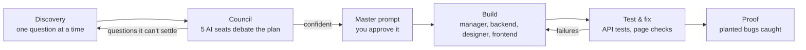

# Vision

**Other builds what you typed. Vision builds what you need, and proves it works.**

Vision is a team of AI agents that takes an app idea from a first conversation to a running, tested React app.
Before any code is written it interviews you, has a council of different AI models debate your plan, and asks
you what they still disagree about. Then it builds the app tests-first and shows you how many planted bugs those
tests catch.

Built in 24 hours at a hackathon (16:00 → 07:00).

---

## How it works



1. **Discovery.** An interviewer asks one question per message. The first few learn who you are (your role and how
   technical you are), and that sets how deep the rest of the questions go. Your answers become a Blueprint: users,
   roles, features, data and pages.
2. **Council.** Five seats, each a different AI model, review the Blueprint using
   [crossexam](https://pypi.org/project/crossexam/) (vendored in `vendor/crossexam`):
   - **Architect:** data model, API, scale
   - **Product lead:** users, roles, first-version features, journeys
   - **Security & payments:** login, permissions, money, abuse, privacy
   - **Skeptic:** contradictions, unrealistic scope, missing edge cases
   - **Designer:** screens, flow, mobile vs desktop, look and feel

   They write findings blind (sealed so nobody copies), then open them and challenge or concede each other's claims.
   A head of discussion writes the outcome, and a translator turns the open points into plain questions for your
   level. Those go back to Discovery, and this repeats until confidence reaches the target or the round limit is hit.
   Confidence is calculated from Blueprint coverage and the strictest seat's score, not self-reported by a model.
   You watch the debate live as a network of seats with messages flowing between them.
3. **Master prompt.** One document that describes the app and gives every build agent its job. You read it and approve it.
4. **Build.** The head manager designs the API contract and splits the work into tasks with dependencies. The QA
   agent writes edge-case tests from the contract **before any code exists**. The backend developer, designer
   (theme) and frontend developer then work in dependency order and leave each other notes.
5. **Test & fix.** The generated app starts in its own folder on its own port. Vision runs a real frontend build,
   the API tests, and loads every page in a simulated browser to catch crashes. QA explains failures in plain words
   and the responsible agent fixes them (up to 3 rounds).
6. **Proof.** Vision plants typical bugs into the finished app one at a time (mutation testing, no AI involved),
   reruns the tests and counts how many they catch. The real code is always put back.

You get a live preview and can download the app as a .zip.

## What a generated app is

Every build starts from `templates/starter`, a working app the agents extend:

- **Backend:** Express + SQLite (`node:sqlite`), with login (register, sign in, `me`) already in place
- **Frontend:** React + Vite + Tailwind + React Router, a component kit, lucide icons and recharts for dashboards
- Pages route themselves; apps with signed-in users get dashboards

Agents can only write to `db/`, `routes/`, `web/src/pages/`, `web/src/components/`, `web/src/theme.css` and
`web/src/site.js`. `templates/starter/CONVENTIONS.md` is their rulebook.

## Any AI in any position

Each step in the flow is a **slot** (questioning agent, council seats, master prompt writer, backend developer and
so on). On the **AI parts** page (`/parts`) you plug in keys and choose which model sits in each slot. Each slot has a
recommended chain of models: if one hits a rate limit, a daily limit or a bad key, the call moves on to the next one,
so work spreads across providers instead of queueing on one.

| Provider | Cost |
|---|---|
| Groq, Google Gemini, NVIDIA (DeepSeek, Kimi), Mistral, Cerebras, SambaNova | free tiers |
| Claude (Anthropic) | paid, optional; first choice for the master prompt, manager and developers |

Model lists come from each provider's own `/models` endpoint, so Vision only picks models that exist. Calls are paced
under each provider's free-tier limits, JSON answers are validated with zod, and an invalid answer is retried once
with the validation error.

**Keys stay private.** Keys entered on `/parts` are encrypted at rest (AES-256-GCM) in `data/`, which is never
committed. The browser only ever sees the last 4 characters. Keys in `.env.local` also work.

## Run it

Needs **Node 22.13+** and **Python 3.9+** (for the council). Step-by-step guide, Windows included: [LAUNCH.md](LAUNCH.md).

```bash
git clone https://github.com/J-J22/Vision.git
cd Vision
npm run setup        # installs Vision and the starter app
npm run doctor       # checks this machine and says exactly what to fix
npm run dev          # http://localhost:3000
```

Then open **http://localhost:3000/parts** and add at least one free key, e.g. Groq
(https://console.groq.com/keys) or Gemini (https://aistudio.google.com/apikey). Or copy `.env.example` to
`.env.local` and fill in keys there.

| Page | What |
|---|---|
| `/` | Start a project: type your app idea |
| `/p/<id>` | The project; jumps to its current stage (discovery, council, master) |
| `/build/<id>` | Build: pipeline, live preview, task lanes, test scorecard, team chat |
| `/build/sample` | Skips Discovery and builds `lib/sample-blueprint.json` |
| `/parts` | AI keys and which model runs each slot |

**No key, or working on screens?** Set `VISION_FAKE_AGENTS=1` in `.env.local`. Build agents then use hand-written
reference code, and a build finishes in about 15 seconds. Discovery and the council still need a key.

### Settings (`.env.local`, all optional)

| Variable | Default | What |
|---|---|---|
| `VISION_CONFIDENCE_TARGET` | `0.8` | Council confidence needed to move on |
| `VISION_MAX_ROUNDS` | `2` | Most council rounds |
| `VISION_FIX_RETRIES` | `3` | Most test-and-fix rounds |
| `LLM_CONCURRENCY` | `3` | Model calls running at once |
| `GROQ_REASONING_EFFORT` | `low` | How long gpt-oss models think (`low`, `medium`, `high`) |
| `VISION_SECRET` | random | Master secret for the key vault |
| `VISION_FAKE_AGENTS` | `0` | `1` builds without AI |

### Scripts

| Command | What |
|---|---|
| `npm run dev` | Start Vision (runs a quick doctor check first) |
| `npm run doctor` | Full check of Node, Python, packages, keys and network |
| `npm run models` | List the models your Groq key can use |
| `npm run typecheck` | TypeScript check |
| `npm run test:reference` | Run the edge-case tests against the hand-written reference API |

## Project layout

| Path | What |
|---|---|
| `app/` | Next.js pages: landing, `p/[id]` (discovery, council, master), `build/[id]`, `parts` |
| `app/api/projects` | Create projects, send actions, stream updates (SSE) |
| `app/api/build` | Start a build, stream its events, download the .zip, rerun the proof |
| `app/api/council-llm/v1` | OpenAI-style relay crossexam talks to; forwards each seat to its slot |
| `lib/project.ts` | Project stages: discovery → council → discovery ↻ → master → build |
| `lib/agents/` | Interviewer, Blueprint draft, master prompt, manager, coders, QA |
| `lib/council.ts` | Runs the crossexam debate and turns the outcome into questions |
| `lib/parliament/` | Backup review panel and the confidence score |
| `lib/llm.ts`, `lib/slots.ts`, `lib/providers.ts`, `lib/claude.ts` | Model calls, slots, providers, fallback chains, pacing |
| `lib/runner.ts` | Build pipeline: plan → agents → start app → tests → fix loop → proof |
| `lib/sandbox.ts` | Workspaces, writable paths, frontend build, page checks, starting apps |
| `lib/proof.ts` | Mutation testing: planted bugs and how many the tests catch |
| `lib/vault.ts` | Encrypted key storage |
| `lib/types.ts` | Shared data formats (Blueprint, tasks, events) |
| `components/` | Page frame, pixel eye, avatars, Markdown renderer, live project hook |
| `templates/starter/` | The app every build starts from, plus `CONVENTIONS.md` |
| `tests/` | Edge-case test runner and the hand-written reference API |
| `vendor/crossexam/` | crossexam 0.6.1, unmodified (MIT) |
| `scripts/` | doctor, model list, reference tests |

Generated apps go in `workspaces/<build id>/` and are not committed.

## Limits

- Generated apps run as local Node processes in their own folders and ports. They are isolated by folder, not
  sandboxed in containers.
- Free tiers have daily token limits. A full run (council plus build) uses a lot, so add keys from more than one
  provider, or plug in Claude.
- A build takes several minutes, depending on which models are in the slots.

## More

- [LAUNCH.md](LAUNCH.md): setup guide
- [PLAN.md](PLAN.md): the original hackathon plan
- `docs/plan.html`, `docs/build-plan.html`: plan pages (open in a browser)
